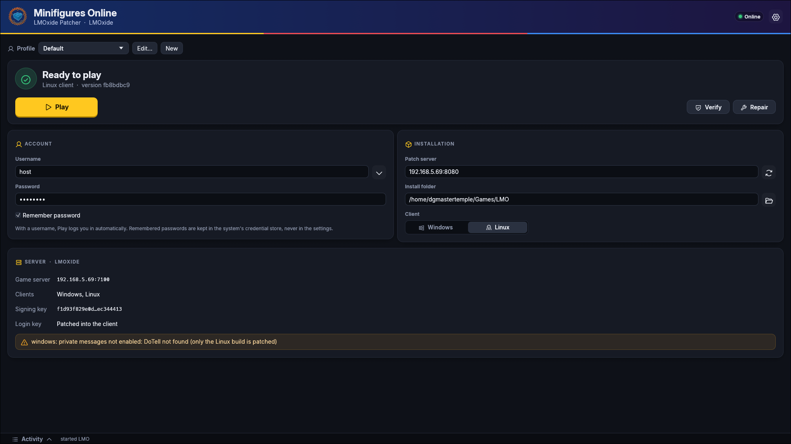
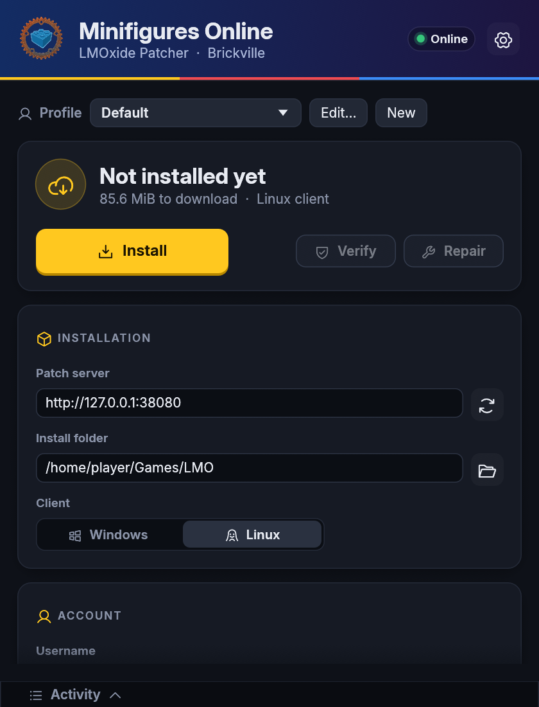

# LMOxide Patcher

A desktop launcher for **LEGO Minifigures Online** on an [LMOxide](https://github.com/LMOxide/lmoxide)
server. Point it at a patch server and it installs the client, keeps it up to date, checks and
repairs it, and starts it already logged in.



- **Install and update** only what changed, resuming interrupted downloads
- **Verify and repair** an install against the server's signed manifest
- **Play** with automatic login; passwords optionally kept in the system keyring
- **Profiles** for several servers, accounts, clients (Linux or Windows) or Wine/Proton setups
- **Updates itself** when the server offers a newer signed build

## How it works

It is a native Rust app built on [egui](https://github.com/emilk/egui) (eframe, OpenGL), one
binary with its fonts and icons embedded. The patching itself is the `lmoxide-patch` crate from
the lmoxide repo, the library the `lmoxide-patcher` command-line tool uses, so both read and
write the same install folders.

1. The patch server publishes a manifest of every client file (path, size, sha256), signed with
   its ed25519 key.
2. The patcher trusts that key on first install (after asking you) and rejects manifests signed
   with any other key.
3. It downloads the files that differ from the manifest, checks each one's sha256, and removes
   the files the server dropped. That makes plain HTTP safe against tampering.
4. **Play** runs the client the way the manifest says, plus the profile's wrapper (e.g. `wine`),
   arguments and environment.

Its state lives in `<install>/.lmoxide/`. Window settings are kept by eframe
(`~/.local/share/lmoxide-patcher/` on Linux).

## Install without Rust

Download the patcher for your system from the
[Releases](https://github.com/LMOxide/lmoxide-patcher/releases) page and run it. Nothing else
to install.

| System | File |
|---|---|
| Windows | `lmoxide-patcher-gui-<version>-windows.exe` |
| Linux | `lmoxide-patcher-gui-<version>-linux` (`chmod +x` it first; glibc 2.36 or newer) |
| macOS | `lmoxide-patcher-gui-<version>-macos.tar.gz` (Apple silicon and Intel; unsigned: right click → Open the first time) |

On Windows and Linux it then updates itself when the server offers a newer build. Server hosts:
the Windows and Linux files are named as the patch server's `--patcher-dir` expects, so they can
be put there as they are (lmoxide's
[HOSTING.md](https://github.com/LMOxide/lmoxide/blob/main/docs/HOSTING.md)).

## Setup

You need Rust (edition 2024), and the lmoxide repo checked out next to this one: the
patcher library comes from it by path.

```
lego-minifigures-online/
├── lmoxide/                 # server monorepo (crates/lmoxide-patch)
└── lmoxide-patcher/         # this repo
```

```sh
cargo build --release        # → target/release/lmoxide-patcher-gui
```

Run it, enter the patch server's address (e.g. `http://192.168.1.10:8080`; `LMOXIDE_SERVER`
fills it in on first start), and press **Install**.

<details>
<summary>Platform notes</summary>

- **Linux**: works under Wayland and X11. "Browse…" uses the XDG desktop portal; without one,
  type the path. Remembered passwords need a Secret Service (GNOME Keyring, KWallet).
- **Windows**: passwords go to Credential Manager.
- **macOS**: passwords go to the Keychain.
- To run the Windows client on Linux, pick **Windows** as the client. The profile then starts it
  with `wine`; set the profile to use `proton run` or another wrapper instead.

</details>

<details>
<summary>More screenshots</summary>

| First start | Trusting a new server | Ready to play (narrow window) |
|---|---|---|
|  |  |  |

</details>

## Documentation

- [User guide](docs/USER-GUIDE.md): every button, profiles, server keys, self-update
- [Development](docs/DEVELOPMENT.md): code layout, tests, scripted screenshots, test servers
- [API proposals](docs/API-PROPOSALS.md): the lmoxide changes this patcher asked for (all landed)
- [`docs/PATCHING.md`](https://github.com/LMOxide/lmoxide/blob/main/docs/PATCHING.md) in lmoxide:
  the patch server, manifests and the `.lmoxide/` folder

## License

MIT, like LMOxide. The embedded fonts keep their own licenses: Inter (SIL Open Font License
1.1, `assets/fonts/Inter-LICENSE.txt`) and Phosphor Icons (MIT,
`assets/fonts/Phosphor-LICENSE.txt`).
