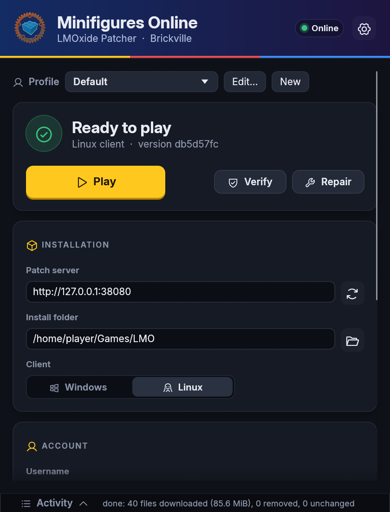
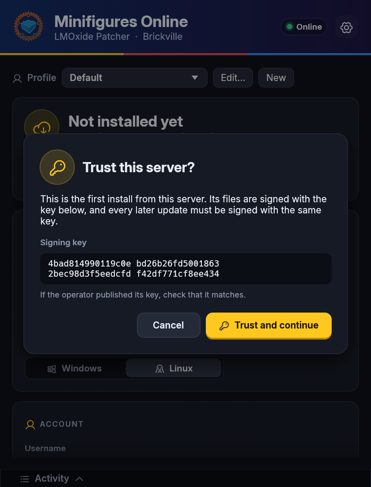

# User guide

[← README](../README.md)

The window shows the **profile** in use at the top, then a status card (the install's state,
progress while installing, and the main button), the **Installation** and **Account** cards, and
the server's details. The header chip says whether the server answered; **Activity** at the
bottom expands into the log.

## Installing and playing

1. **Patch server** (Installation): the patch server's address, e.g. `http://192.168.5.69:8080`
   (a bare `host:port` means `http://`). `LMOXIDE_SERVER` fills it in on first start. Press
   Enter or the refresh button: the window shows the server's name, game address, clients on
   offer and any warnings, and whether the install is current. While the server is still
   indexing, the patcher checks again every 10 seconds.
2. **Install folder**: where the client goes (default `~/Games/LMO`). **Client**: the Linux or
   Windows build (default: this system's).
3. **Install / Update** downloads whatever differs from the server's signed manifest and deletes
   the files the server removed. **Cancel** stops; the next update resumes interrupted downloads.
4. **Verify** compares the install with the manifest without changing anything and lists the
   differences. **Repair** rehashes every file (instead of trusting unchanged size and
   modification time) and fixes whatever differs.
5. **Play** starts the client as the manifest says (executable, arguments, environment).
6. **Game Mode** (Server card): the server's game modes, e.g. **Progression** (as live: level 1
   up, XP, stars, ranks), **Maxxed** (everything unlocked) and **World Editor** (for the server's
   world editors). Each mode has its own characters. The choice is kept per profile and in the
   install (`.lmoxide/mode`); changing it updates the install at once, which only rewrites the
   client's `LocalConfig.xml` (the mode's game address; the client's own patcher keeps it).
   A server with one mode shows just its name.

Enter (outside a text field) presses the yellow button. The gear opens the settings: parallel
downloads, and whether to offer newer versions of the patcher.

## Accounts and passwords

With a **Username**, Play logs the client in automatically with that name and the password in
the window. Play needs a password whenever a username is set.

Each profile remembers the accounts it was used with: the arrow beside the username lists them
(newest first; × forgets one). Tick **Remember password** and Play saves the password in the
system's credential store, never in the settings file:

| System | Store |
|---|---|
| Linux | Secret Service (GNOME Keyring, KWallet) |
| Windows | Credential Manager |
| macOS | Keychain |

Picking the account later fills the password in. Unticking the box forgets it.

## Profiles

A profile is one way to play: patch server, install folder, client, username, and how to start
the client. Pick one in the **Profile** list at the top.

- **New** copies the current profile without its accounts. Several profiles can share an install
  (e.g. for two accounts) or point at different servers or clients.
- **Edit…** sets the profile's name and how it starts the client:
  - **Start the client with**: a program to run it through, e.g. `wine` (the default for the
    Windows client on Linux), `proton run`, `gamemoderun`. Empty starts it directly.
  - **Extra arguments**, added after the server's own.
  - **Environment**: `NAME=value` lines, e.g. `WINEPREFIX=/home/me/.wine-lmo`.
- **Delete profile** (in Edit…) forgets the profile and its saved passwords (unless another profile uses the same
  account on the same server). Its install stays on disk.

Settings from the first version (one server and folder) become the first profile.

## Trusting a server

Manifests are signed with the server's ed25519 key. The first install from a server shows that
key and asks before trusting it (the CLI trusts it silently). It is then stored in
`<install>/.lmoxide/server-key`.

If a later manifest is signed with a different key, the window says so and shows both keys. Only
accept the new one if the server's operator changed it.

File bodies are checked against the signed sha256, so plain HTTP is safe against tampering.

 

## Updating the patcher

If the server hands out patcher builds and has a newer `lmoxide-patcher-gui` for this system, a
banner offers it. The build must be signed with the key the current profile's install trusts, so
nothing is offered before a first install.

**Update the patcher** downloads it next to this program, checks it against the signed sha256 and
swaps it in; **Restart the patcher** then starts the new version. The settings can turn the offer
off.

Publishing a patcher build (server operators)

Start the patch server with `--patcher-dir` (see
[`docs/PATCHING.md`](https://github.com/LMOxide/lmoxide/blob/main/docs/PATCHING.md) in lmoxide).
Copy the build into that directory as `lmoxide-patcher-gui-<version>-<linux|windows>[.exe]`,
with the version from `Cargo.toml`, and send the server `SIGHUP`.

## Files

| Where | What |
|---|---|
| `<install>/.lmoxide/` | trusted key, hash cache, last manifest, partial downloads (shared with `lmoxide-patcher`) |
| `~/.local/share/lmoxide-patcher/` (Linux) | window settings and profiles, kept by eframe |
| system credential store | remembered passwords |
